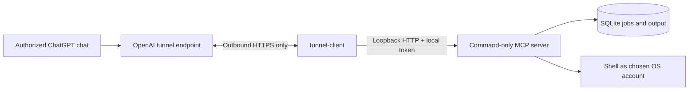

# Private command MCP tunnel starter

> V2 development branch: see [REWRITE.md](REWRITE.md) for the clean-slate agent-operated installation plan. This branch is experimental; main remains unchanged.

A standalone, command-only MCP server for ordinary ChatGPT chats through [OpenAI Secure MCP Tunnel](https://developers.openai.com/api/docs/guides/secure-mcp-tunnels). It targets native Windows and Linux; actual-machine acceptance remains outstanding. It does **not** require Codex, SSH, a public web server, or the VPS gateway from which this project was adapted.

The MCP tool list is exactly:

| Tool | Purpose |
| --- | --- |
| `start_command` | Start a Bash (Linux) or PowerShell (Windows) command and return a job ID immediately. |
| `get_command` | Poll status, exit code, and new combined stdout/stderr using byte offsets. |
| `cancel_command` | Stop a running process tree; earlier effects can remain. |

Commands can overlap. The default limit is four active commands, two hours per command, and 30 MiB of saved output. Job metadata is persisted in SQLite outside the repo. A repeated `request_id` UUID returns the same job, and jobs interrupted by service restart are never replayed automatically.

## Before touching the target machine

The setup agent should ask the user:

- Is the target **native Windows or Linux**, and which machine should execute commands?
- Which **OS user** should commands run as? What should that account be allowed to read, change, or elevate?
- Which **ChatGPT workspace/account** will use the plugin? Which **OpenAI Platform organization** owns the tunnel? Does the user have permission to create a custom MCP server and a tunnel?
- Should the service run only while the user is logged in or continue after logoff/reboot?
- Which absolute working directory and concurrency/timeout limits should be used?

Obtain the tunnel ID and runtime API key locally. Do not paste a key into GitHub issues, ChatGPT, or this repository. The `init` command prompts for the key without displaying it.

## Agent-operated installation (preview)

Start with [the agent setup guide](docs/AGENT-SETUP.md). Run the OS-specific installer in a local terminal on the target machine. It bootstraps dependencies when needed and supports lifecycle commands and JSON diagnostics. Use manual instructions below only for troubleshooting.

## Setup map

1. Read [SECURITY.md](SECURITY.md) and [the agent setup guide](docs/AGENT-SETUP.md). Select the actual target computer, account and startup preference.
2. In OpenAI Platform, create a **new Secure MCP Tunnel** and associate the intended Platform organization and ChatGPT workspace. Obtain a runtime key with Tunnels Read + Use. See the [official tunnel guide](https://developers.openai.com/api/docs/guides/secure-mcp-tunnels).
3. Run the appropriate native entrypoint in a local interactive terminal:

       bash scripts/install.sh install
       powershell -NoProfile -File scripts/install.ps1 install

   The installer handles dependencies, local credential prompts and background services. For unattended startup, explicitly authorize and use the option in the agent setup guide.
4. Run the same entrypoint with the diagnostics action and verify local authentication, readiness and service registration.
5. In [ChatGPT Plugins](https://chatgpt.com/plugins), add a custom MCP server, choose **Tunnel**, select or paste the tunnel ID, install the plugin, and confirm the three tools. Start a fresh ordinary ChatGPT chat and select the plugin. See the [official connection steps](https://developers.openai.com/plugins/deploy/connect-chatgpt).
6. Run a harmless command and confirm its exit code and output. Local readiness is not proof of end-to-end connectivity.

If the ChatGPT setup presents an authentication option for this local-token design, choose **No authentication** there: tunnel-client injects the local token. The local server is still authenticated. The connector cannot operate while the computer is asleep or powered off.

## Architecture

The server listens at `127.0.0.1:18202/mcp/`; `tunnel-client` readiness listens at `127.0.0.1:18203/readyz`. Both ports are local only. The config and runtime state live outside the Git checkout in the user's config/state directories. `tunnel-client` needs outbound HTTPS to `api.openai.com:443` (or the documented mTLS endpoint when configured), plus local reachability to the MCP server. No inbound firewall rule is needed.

## Tool behavior

`start_command(command, request_id, cwd?, timeout_seconds?)` returns `job_id`, current `status`, and output fields. Generate a fresh UUID for a new command. Reuse the **same** UUID and unchanged arguments after an uncertain call. Use `get_command(job_id, offset=next_offset)` until terminal status and all output bytes have been read. `cancel_command(job_id)` requests cancellation; poll again for the final state. The output is combined stdout/stderr and is not a terminal or interactive session.

The following are terminal statuses: `completed`, `failed`, `timed_out`, `cancelled`, `interrupted`. An `interrupted` job after restart may already have changed the host; inspect the host before deciding whether to submit a new command with a new UUID. The service never runs that job again automatically.

The 30 MiB cap is written into the private config by `command-mcp init`. Updating this repository does not overwrite an existing config. To change an existing installation, set `max_output_bytes` to `31457280` in its private `config.json`, wait for active jobs to finish, and restart `command-mcp serve`. The tunnel process can keep running.

## Files

- `src/command_mcp_tunnel_starter/`: MCP server, durable command engine, and launcher.
- `docs/LINUX.md`, `docs/WINDOWS.md`: OS-specific install and startup.
- `SECURITY.md`: trust boundary, key handling, and recovery.
- `docs/TROUBLESHOOTING.md`: connection and job diagnosis.
- `tests/`, `.github/workflows/test.yml`: tests on Ubuntu and Windows.

## Reliability roadmap

See [TODO.md](TODO.md) for outstanding automatic startup, recovery and real-device verification work.

## Development

`uv run --frozen pytest -q` checks the command engine, auth, and exact tool surface. The lockfile is committed; use `uv sync --frozen` for deployment. CI runs the same suite on Windows and Linux. This private-tunnel pattern is for personal/workspace use; the [official plugin guide](https://developers.openai.com/plugins/deploy/connect-chatgpt) says a public plugin submission needs a public HTTPS endpoint.
