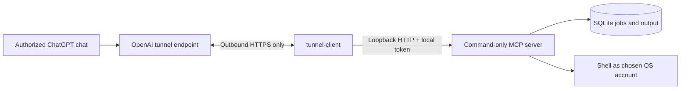

# Private command MCP tunnel starter

A standalone, command-only MCP server for ordinary ChatGPT chats through [OpenAI Secure MCP Tunnel](https://developers.openai.com/api/docs/guides/secure-mcp-tunnels). It works on native Windows and Linux. It does **not** require Codex, SSH, a public web server, or the VPS gateway from which this project was adapted.

The MCP tool list is exactly:

| Tool | Purpose |
| --- | --- |
| `start_command` | Start a Bash (Linux) or PowerShell (Windows) command and return a job ID immediately. |
| `get_command` | Poll status, exit code, and new combined stdout/stderr using byte offsets. |
| `cancel_command` | Stop a running process tree; earlier effects can remain. |

Commands can overlap. The default limit is four active commands, two hours per command, and 30 MiB of saved output. Job metadata is persisted in SQLite outside the repo. A repeated `request_id` UUID returns the same job, and jobs interrupted by service restart are never replayed automatically.

## Before touching the target machine

The setup agent should ask the user:

- Is the target **native Windows or Linux**, and which machine should execute commands?
- Which **OS user** should commands run as? What should that account be allowed to read, change, or elevate?
- Which **ChatGPT workspace/account** will use the plugin? Which **OpenAI Platform organization** owns the tunnel? Does the user have permission to create a custom MCP server and a tunnel?
- Should the service run only while the user is logged in or continue after logoff/reboot?
- Which absolute working directory and concurrency/timeout limits should be used?

Obtain the tunnel ID and runtime API key locally. Do not paste a key into GitHub issues, ChatGPT, or this repository. The `init` command prompts for the key without displaying it.

## Agent-operated installation (preview)

Start with [the agent setup guide](docs/AGENT-SETUP.md). Run the OS-specific installer in a local terminal on the target machine; use the manual instructions below for fallback.

## Setup map

1. Read [SECURITY.md](SECURITY.md). The plugin gives its authorized users direct shell authority of the chosen OS account.
2. Follow [Linux](docs/LINUX.md) or [Windows](docs/WINDOWS.md) to install Git, `uv`, Python 3.12, and the official `tunnel-client` binary.
3. In OpenAI Platform, create a **new Secure MCP Tunnel** and associate the intended Platform organization **and** ChatGPT workspace. Give the operator Tunnels Read + Use. See the [official tunnel guide](https://developers.openai.com/api/docs/guides/secure-mcp-tunnels).
4. In the repo, run `uv sync --frozen`, then `uv run --frozen command-mcp init` as the selected execution account.
5. Start `uv run --frozen --no-sync command-mcp serve` and `uv run --frozen --no-sync command-mcp tunnel` in separate terminals or OS services.
6. Run `uv run --frozen --no-sync command-mcp check`. It requires local unauthenticated access to be denied, authenticated health to succeed, and the tunnel to report ready.
7. In [ChatGPT Plugins](https://chatgpt.com/plugins), add a custom MCP server, choose **Tunnel**, select or paste the tunnel ID, create/install the personal plugin, and confirm exactly the three tools above. Start a **new ordinary ChatGPT chat** and select the plugin with `@`. See [official connection steps](https://developers.openai.com/plugins/deploy/connect-chatgpt).
8. Ask for a harmless command such as `pwd` on Linux or `Get-Location` on Windows. Confirm `get_command` shows exit code 0. Then test a long command and a second short command while it runs.

The ChatGPT connection can use its tunnel association instead of exposing a public endpoint. If the ChatGPT setup presents an authentication option for this local-token design, choose **No authentication** there: `tunnel-client` injects the local `X-Command-MCP-Token` header. This does **not** make the MCP server anonymous; the local server still rejects requests without its token, and ChatGPT access depends on account/workspace/tunnel permissions.

## Architecture

The server listens at `127.0.0.1:18102/mcp/`; `tunnel-client` readiness listens at `127.0.0.1:18103/readyz`. Both ports are local only. The config and runtime state live outside the Git checkout in the user's config/state directories. `tunnel-client` needs outbound HTTPS to `api.openai.com:443` (or the documented mTLS endpoint when configured), plus local reachability to the MCP server. No inbound firewall rule is needed.

## Tool behavior

`start_command(command, request_id, cwd?, timeout_seconds?)` returns `job_id`, current `status`, and output fields. Generate a fresh UUID for a new command. Reuse the **same** UUID and unchanged arguments after an uncertain call. Use `get_command(job_id, offset=next_offset)` until terminal status and all output bytes have been read. `cancel_command(job_id)` requests cancellation; poll again for the final state. The output is combined stdout/stderr and is not a terminal or interactive session.

The following are terminal statuses: `completed`, `failed`, `timed_out`, `cancelled`, `interrupted`. An `interrupted` job after restart may already have changed the host; inspect the host before deciding whether to submit a new command with a new UUID. The service never runs that job again automatically.

The 30 MiB cap is written into the private config by `command-mcp init`. Updating this repository does not overwrite an existing config. To change an existing installation, set `max_output_bytes` to `31457280` in its private `config.json`, wait for active jobs to finish, and restart `command-mcp serve`. The tunnel process can keep running.

## Files

- `src/command_mcp_tunnel_starter/`: MCP server, durable command engine, and launcher.
- `docs/LINUX.md`, `docs/WINDOWS.md`: OS-specific install and startup.
- `SECURITY.md`: trust boundary, key handling, and recovery.
- `docs/TROUBLESHOOTING.md`: connection and job diagnosis.
- `tests/`, `.github/workflows/test.yml`: tests on Ubuntu and Windows.

## Reliability roadmap

See [TODO.md](TODO.md) for outstanding automatic startup, recovery and real-device verification work.

## Development

`uv run --frozen pytest -q` checks the command engine, auth, and exact tool surface. The lockfile is committed; use `uv sync --frozen` for deployment. CI runs the same suite on Windows and Linux. This private-tunnel pattern is for personal/workspace use; the [official plugin guide](https://developers.openai.com/plugins/deploy/connect-chatgpt) says a public plugin submission needs a public HTTPS endpoint.
